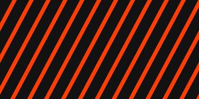
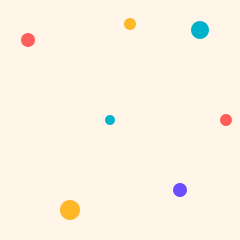
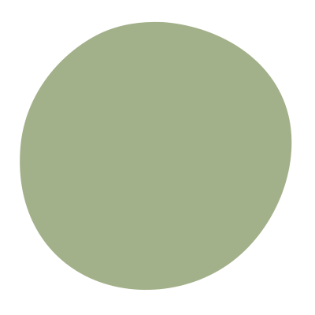

# Textures and patterns

Vector patterns and shapes taken from the styles' graphic elements, so the
same devices can be used outside the browser (print, social templates, slides).

| Preview | File | Style | Use |
| --- | --- | --- | --- |
|  | `khatam-star-tile.svg` | Modern Heritage | 48px repeating tile; pattern bands and borders. Fade it out across the layout rather than using it as full wallpaper. |
|  | `swiss-grid.svg` | Swiss Precision | Visible 6-column grid with the red square marker, 1200 × 800 |
|  | `speed-stripes.svg` | Kinetic Sport | Diagonal Blaze stripes on Asphalt; mask with a gradient so they fade |
|  | `confetti-dots.svg` | Playful Pop | 240px repeating confetti tile |
|  | `dot-grid-glow.svg` | Future Tech | Background field, 16:9 |
|  | `organic-blob.svg` | Organic Earth | Pebble mask for photography |

Colours are the styles' palette values. Recolour by editing `fill` and
`stroke`; keep to the style's palette roles. For print, convert to CMYK or
spot in the layout application; Modern Heritage's gold should become foil or
metallic ink.

Licence: made for the agency; free to use in client work.
